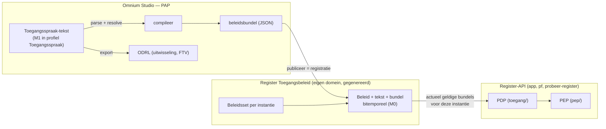
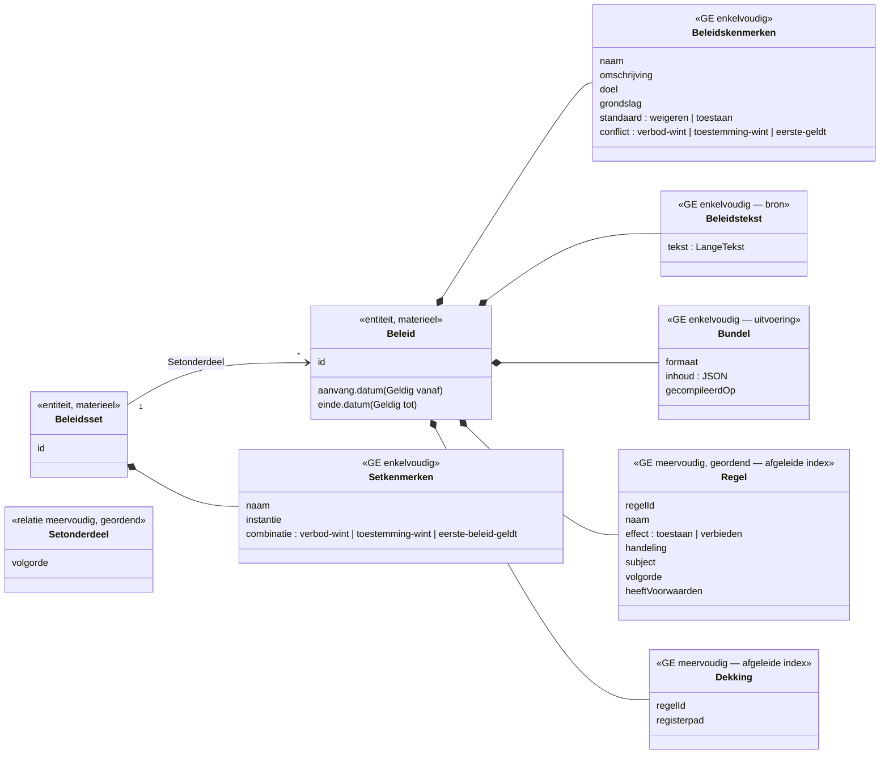

# Register Toegangsbeleid — samenvatting en voorstel CM

> 2026-10-13. Voorbereiding op een gesprek met Mark over fase 1c ("de bundel meteen
> bitemporeel opslaan"). Samenvatting van wat er al ligt
> (`ODRL-Register-Toegangsbeleid.md` §5, `Whitepaper-Register-Toegangsbeleid.md` §4 en
> bijlage B) en een voorstel voor een canoniek model, aangepast aan wat sinds 12-10 gebouwd is.
> Niets gebouwd; alles hieronder is ter bespreking.

## 1. Waar het om gaat

Toegangsbeleid verandert ook: wetten, organisaties en fouten. Een auditor vraagt *"welk beleid
gold op 15 maart 2025 om 14:00, en op welke grondslag?"*. Dat is precies de vraag die een
bitemporeel register beantwoordt. Het voorstel uit april was daarom: maak van het
toegangsbeleid **zelf een register**, met dezelfde v06-architectuur — een eigen domein dat
Omnium genereert, zoals elk ander register (dogfooding).

| Tijd | Vraag | Voorbeeld |
|---|---|---|
| formeel | wanneer is dit beleid vastgelegd? | geregistreerd op 1-10-2026 |
| materieel | vanaf wanneer geldt het? | geldt vanaf 1-1-2027 (wetswijziging) |

De vier scenario's uit de whitepaper (§4.2): reguliere wijziging met toekomstige ingang,
correctie van een fout zonder de audit-trail te verliezen, audit achteraf (formeel tijdreizen),
en beleid over meerdere registers heen.

## 2. Hoe het past in wat er nu is

Nu laadt de API één bundel uit een bestand (`TOEGANG_BUNDEL`). Fase 1c vervangt dat bestand
door het register: publiceren vanuit de Studio is een **registratie**, en de PDP leest de
bundels die nu (formeel én materieel) gelden voor zijn instantie.

**Metaniveaus.** Een concreet beleid ("CG portfolio") is in de Studio een **M1-model** in het
profiel Toegangsspraak. In het register is datzelfde beleid **M0-data**: een record van het
canonieke model van het beleidsregister (dat zelf weer M1 is, in canoniek-uml). Publiceren is
de brug: M1 (Studio) → M0 (register). Vergelijkbaar met hoe een schema-versie nu als rij in
`schema_versies` belandt — maar dan als gemodelleerd, bitemporeel register in plaats van een
plumbing-tabel.

## 3. Het voorstel uit april (whitepaper, bijlage B) — en waarom bijstellen

April: `Beleid` met losse tabellen `BeleidPermission`, `BeleidProhibition`, `BeleidObligation`,
`BeleidConstraint` (ODRL plat geslagen), plus `_Aanvang`/`_Einde`.

Wat sindsdien veranderd is:

1. **De tekst is de bron.** Toegangsspraak is de taal; de Studio parseert en compileert. Het
   beleid opnieuw als losse ODRL-rijen opslaan betekent een tweede waarheid en een tweede
   parser — precies wat we bij B4 wilden vermijden.
2. **Voorwaarden zijn bomen** (en/of/xof, genest). Platte constraint-rijen met een verwijzing
   naar "permission_rel_id" passen daar slecht op.
3. **Nieuw sinds 12-10:** superpolicy (`Standaard`, `Bij conflict`), volgorde als prioriteit
   (eerste regel geldt), `Iedereen`, begrippen, plichten — en beleid **per instantie** (B2).
4. **Wat de PDP uitvoerde, moet terug te vinden zijn.** Voor audit wil je niet alleen de tekst,
   maar ook de exacte bundel die op moment *t* gold.

## 4. Voorstel CM (domein `toegang`)

Bron + uitvoering + bevraagbaarheid, elk op zijn plek:

- **Beleidstekst** — de bron (geversioneerd);
- **Bundel** — wat de PDP uitvoert (geversioneerd, afgeleid maar bewaard voor audit);
- **Regel** en **Dekking** — een afgeleide index om te kunnen vragen *"welk beleid raakt
  `NatuurlijkPersoon.persoonsidentificaties.bsn`?"* zonder de tekst te parsen;
- **Beleidsset** — welke beleiden op welke instantie gelden, in welke volgorde en met welke
  combinatieregel (ook dat is beleid, en ook dat verandert in de tijd).

Toelichting:

- **Materieel** zit op de entiteit (`Beleid_Aanvang`/`_Einde`): de kopregel `Geldig vanaf … tot …`
  wordt bij publiceren de materiële tijd, zoals `odrl.js` hem nu al als transport naar de
  materiële tijd beschrijft.
- **Één registratie per publicatie**: tekst, bundel, kenmerken en de afgeleide index worden in
  dezelfde registratie opgevoerd, dus ze zijn per formeel tijdstip altijd onderling consistent.
- **Correctie** (scenario 2) is een correctie-registratie op hetzelfde beleid; de oude
  tekst en bundel blijven via formeel tijdreizen opvraagbaar.
- **Beleidsset per instantie** lost B2 (*verschilt per site*) en "meerdere beleiden combineren"
  op: pf krijgt bv. de set *CG portfolio* + *Privacy contactgegevens*; het probeer-register een
  set met `Standaard: toestaan` (maar niet voor de plumbing).
- **Wie mag het beleidsregister wijzigen?** Voorlopig zoals domein `beheer`: alleen admin.
  Later: beleid op het beleidsregister zelf (met een vast "bootstrap"-beleid).

## 5. Vragen om samen te beantwoorden

1. **Bron.** Tekst als bron + afgeleide index (dit voorstel), of toch gestructureerd per regel
   zoals in april?
2. **Eén centraal beleidsregister** voor alle instanties (app, pf, probeer-register), of per
   instantie een eigen domein? Eén centraal register maakt beleid over registers heen
   (scenario 4) eenvoudiger; per instantie is losser gekoppeld.
3. **Begrippen herbruikbaar?** Rolgroepen ("een redacteur is: iemand met rol …") nu per beleid
   in de tekst. Wil je ze als eigen entiteit, gedeeld over beleiden — en later gekoppeld aan
   het subjectmodel (organisatie → onderdeel → medewerker → rol, partij)?
4. **Bundel opslaan of steeds opnieuw compileren?** Opslaan is beter voor audit (je ziet wat
   precies gold) en maakt de API onafhankelijk van de compiler; opnieuw compileren voorkomt
   dubbele gegevens.
5. **Combinatie tussen beleiden** in een set: dezelfde drie conflictregels als binnen een
   beleid, of iets anders (bv. "alle beleiden moeten toestaan")?
6. **Domeinnaam en prefix**: `toegang` / `toegang_`?
