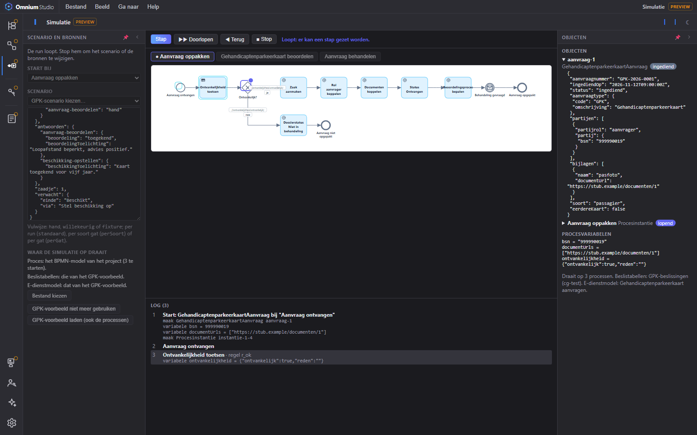
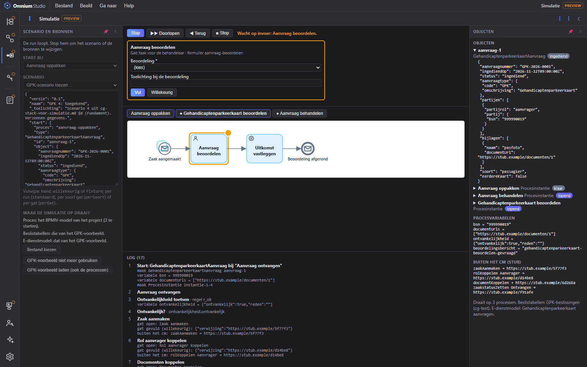
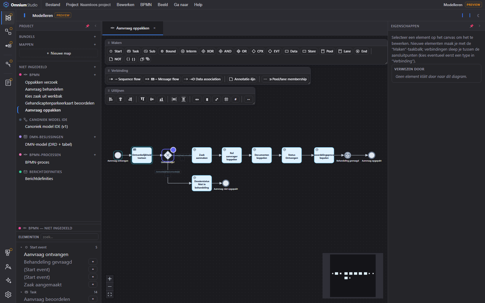

# Simulatie van BPMN en DMN met cm-objecten (ontwerp, 2026-11-12)

Aanleiding: Mark (11-11 en 12-11, Claude-chat over Petri nets, BPMN en DMN): "Ik
zou eigenlijk BPMN en DMN willen kunnen simuleren, liefst met objecten (M0) als
input, met een concreet token dat door de flow gaat. Operaton/Valtimo zit in de
stack, maar echte simulaties heb ik daar niet in gevonden. Misschien is een
simpele simulatie wel te doen in de Studio."

De opdracht voor de bouw staat in
`2026-11-12 Opdracht simulatie BPMN-DMN — kern en eerste demo.md`.

**Bijgewerkt 12-11 (sessie SIMULATIE).** Verwerkt: de review van FUNDAMENT, de
wensen en het besluit van Mark van 12-11 (§0, nummers 8 tot 12) en de
verkenning van fase 0 (§9). De referentie voor wat de simulatie naspeelt is
`docs/cg-stack-voor-simulatie.md` in de repo Fundament: wat de CG-stack met een
GPK-aanvraag doet, per stap in cm-termen, met vijf scenario's. Besloten is
alleen wat in §8 als besloten staat; de rest van §3 en §8 is voorstel.

## 0. Doel en uitgangspunten

**Doel.** Laten zien dat je met een klein universum van elementen veel bereikt:
één aanvraag loopt door een proces en een beslistabel, en aan het eind ligt er
een stapeltje objecten met state, met het spoor erbij dat verklaart hoe ze zo
geworden zijn.

**Uitgangspunten van Mark (12-11).**

| # | Uitgangspunt |
|---|---|
| 1 | Het canoniek model (cm) is de essentie. Berichten, formulieren en API's zijn vorm en komen in de ideale wereld uit het cm. De simulatie praat dus van begin tot eind in cm-termen. |
| 2 | BPMN heeft een eigen M2 (het `bpmn`-profiel op de diagram-motor). De simulatie leest het M1-model in die vorm, geen BPMN-XML. |
| 3 | DMN mag eenvoudig: gewone beslistabellen, of een boompje van tabellen. FEEL hoeft niet. |
| 4 | Expressies lopen via de bestaande CEL-subset-evaluator, die cm-paden begrijpt. |
| 5 | De koppeling tussen cm en BPMN loopt langs vier wegen en niet meer: input-events (message of signal) met een cm-object als lading, message flows waarover cm-objecten stromen, data stores die cm-objecten vasthouden, en datamanipulatie die alleen binnen het proces gebeurt. |
| 6 | De store is voor "fire and forget" tijdelijk. De luxe variant bewaart hem, zodat ketens en bundels te testen zijn. |
| 7 | Adapters naar echte data stores, met vertalingen, zijn voor een volgende versie. |
| 8 | (12-11) Gegevens blijven in cm-taal; de M0-store komt erbij. |
| 9 | (12-11) Het formulier bij een gat is rudimentair, naar het type. Noemt de user task een formulier, dan gebruikt het gat dat formulier. Een form.io-weergave mag, hoeft niet. Zie vraag 9 in §8. |
| 10 | (12-11) Op elke plek waar gegevens in moeten staat een stub: willekeurig of uit een fixture. De vulwijze is per gat of per run in te stellen, zodat een run zonder stoppen doorloopt. Een bericht naar een pool zonder proces (ketenpartner) is ook een gat met een stub. |
| 11 | (12-11) Simulaties bewaren op het niveau van een M1-set en een M0-set: niet in de eerste versie, wel het formaat voorbereiden (§3.5). |
| 12 | (12-11, besluit) **CEL is de expressietaal in het model**, ook voor de condities in een proces en de expressies in een beslistabel. JUEL en FEEL zijn uitvoer: een transformatie schrijft ze bij de export naar de engine. Reden: CEL staat al centraal in het cm, in de afgeleide velden en in de GraphQL-resolvers daarvan, en leest natuurlijker zonder `${}`. Zie §3.6. |

Uitgangspunt 12 scherpt 3 en 4 aan: FEEL hoeft de simulatie niet te lezen,
want het model bevat het niet meer.

**Wat het niet is.** Geen tweede process engine. Uitvoeren blijft het werk van
Operaton via `process_engine_v01/`. De simulatie is een denk- en demonstratie-
hulp in de browser en garandeert niet dat Operaton zich identiek gedraagt.

## 1. Het universum

| Element | Wat het is | Niveau |
|---|---|---|
| cm-type | Een type uit het canonieke model. | M1 |
| Object | Een instantie van een cm-type, met data en state. | M0 (simulatie) |
| Procesinstantie | Een lopend proces, subproces of call activity. Zelf ook een object: een instantie van een M1-proceselement. | M0 (simulatie) |
| Token | Wijst naar een plek in het proces en naar de scope van zijn procesinstantie. Draagt zelf geen data. | M0 (simulatie) |
| Event met lading | Een message of signal dat een cm-object draagt. | M1 (soort), M0 (voorkomen) |
| Store | Houdt objecten vast en beantwoordt vragen in cm-paden. | M0 (simulatie) |
| Stap | Een taak die objecten aanmaakt of wijzigt. | M1 |
| Expressie | CEL over cm-paden: condities, toekenningen, correlatie. | M1 |
| Beslistabel | Invoerkolommen als CEL-paden, regels, hit policy. | M1 |
| Gat | Een punt waar de simulatie een waarde nodig heeft die zij niet zelf kan afleiden. | M0 (simulatie) |

"M0 (simulatie)" staat los van het register: er wordt niets in de database
geschreven. CLAUDE.md reserveert M0 voor geregistreerde instanties; de simulatie
gebruikt dezelfde vorm in een eigen, tijdelijke store.

## 2. Hoe een simulatie loopt

De simulator is een interpreter over het M1-procesmodel met een store ernaast.

1. **Start.** Je zet een startobject van een cm-type klaar, bijvoorbeeld de
   payload van een formulier als `Aanvraag`. Dat object is de lading van het
   startevent. Er ontstaat een procesinstantie met één token.
2. **Stap.** Het token komt bij een element. De interpreter voert de regel van
   dat elementtype uit: een gateway evalueert condities, een taak voert haar
   mutaties uit, een business rule task rekent een beslistabel uit, een call
   activity start een kind-instantie.
3. **Gat.** Kan de interpreter niet verder zonder een waarde, dan pauzeert het
   token en ontstaat er een gat met een verwacht type.
4. **Einde.** De simulatie stopt in één van drie toestanden, zie §2.2.

### 2.1 Het gat als enig mechanisme voor invoer

Een user task, een gestubde API-aanroep, een ontbrekende waarde bij een gateway
en het startobject zijn hetzelfde: een gat met een verwacht cm-type of veldtype.
Omdat het type uit het cm komt, kan de Studio er een invoerformulier bij tonen.

Een gat kan op vier manieren gevuld worden:

- met de hand;
- met een willekeurige waarde die bij het type past;
- uit een fixture (een vooraf opgeslagen antwoord, voor herhaalbare runs);
- door de AI-assistent (niet in de eerste versie).

De **vulwijze** is in te stellen per run, met een uitzondering per gat. Staat
de run op "fixture" of "willekeurig", dan stopt hij bij geen enkel gat en loopt
hij in één keer door tot een einde. Staat een gat op "met de hand", dan
pauzeert de run daar. Heeft een fixture voor een gat geen antwoord, dan valt
dat gat terug op "met de hand".

Ook dit zijn gaten:

- een bericht naar een pool zonder proces (een ketenpartner, of de inwoner in
  het portaal): het antwoord dat terugkomt is het gat;
- een servicetaak die iets doet wat de simulatie niet in cm-termen kan lezen:
  het resultaat is het gat;
- een conditie of expressie die de simulatie niet kan lezen, of die een
  variabele noemt die er niet is: de uitkomst is het gat.

Voor herhaalbaarheid legt het spoor bij elk gevuld gat vast welke waarde
gebruikt is en hoe die gekozen is. Een run is dan opnieuw af te spelen zonder
dat iemand iets hoeft in te vullen.

### 2.2 Drie soorten einde

| Einde | Betekenis |
|---|---|
| Zakelijke uitkomst | Alle tokens zijn via een eindevent verbruikt. Een afwijzing is ook een geldige uitkomst. |
| Uitzondering | Een fout-, escalatie- of annuleringsevent heeft het verloop afgebroken. |
| Vastgelopen | Er zijn nog tokens, maar niets kan meer bewegen en er staat geen gat open. Dit is een fout in het model, bijvoorbeeld een join die nooit compleet wordt. |

Het derde geval is een bijvangst: de simulator signaleert een vastgelopen model
zonder dat daar formele analyse voor nodig is.

## 3. Vier keuzes (voorstel)

BPMN laat deze vier punten zelf open. Ze zijn nog niet door Mark bekrachtigd;
zie de vragen in §8.

### 3.1 Het mutatievocabulaire

Als alleen het proces data wijzigt, moet een taak kunnen zeggen wat zij doet.
Voorstel voor de kleinste bruikbare set:

| Mutatie | Betekenis |
|---|---|
| maak | Een nieuw object van een cm-type. |
| zet | Eén of meer velden van een bestaand object. |
| overgang | De state van een object verandert. |
| verbind / ontbind | Een relatie tussen twee objecten ontstaat of vervalt. |

De waarden komen uit een CEL-toekenning of uit een gat.

Het BPMN-profiel heeft al eigenschappen die hierop lijken: `actie` en
`actieDoel` op een service- of gebruikerstaak, `dossierstatus` en
`zetVariabelen` (plan van 05-11, "Servicetaken en dossierstatus uit het
model"). Die zijn gericht op zaakgericht werken en op de vertaling naar GZAC.
Het voorstel is om ze in de simulatie te lezen als bijzondere gevallen van
bovenstaande set, en pas een algemene mutatie-eigenschap toe te voegen als de
demo laat zien wat er ontbreekt.

### 3.2 Referentie of kopie

- **Binnen één afhandeling: referentie.** Procesvariabelen wijzen naar
  objecten in de store. Zo is er één waarheid. Een afhandeling is alles wat
  dezelfde sleutel deelt (§3.3), ook als het over meerdere processen loopt die
  elkaar met berichten starten.
- **Naar een andere partij: kopie.** Een bericht naar een ketenpartner is een
  momentopname in cm-termen. De ontvanger beslist wat hij ermee in zijn eigen
  store doet.

De eerste versie van dit ontwerp legde de grens bij de pool: elk bericht een
kopie. De stack doet het anders (bevinding e van FUNDAMENT): oppakken,
behandelen en beoordelen zijn drie processen met één dossier en één business
key, en de berichten ertussen dragen alleen procesvariabelen. Het voorstel is
daarom de grens bij de partij te leggen; zie vraag 3.

Dit sluit aan op het bestaande Berichttype en het Procescontract (driehoek
proces – regels – data, stap 3 tot 5): die leggen per veld vast wat er over de
grens gaat.

### 3.3 Correlatie

Komt een bericht binnen bij een proces dat al loopt, dan bepaalt een sleutel
welke instantie het krijgt. In de stack is dat de business key van het dossier;
in cm-termen is de sleutel dus het startobject zelf (de aanvraag). Alle
procesinstanties van één afhandeling delen die sleutel. Dat is genoeg voor de
demo. Een sleutelpad als CEL-expressie op het cm-object is pas nodig bij ketens
met een andere partij (fase 3).

Message en signal verschillen alleen in adressering: een message heeft één
ontvanger, een signal bereikt iedereen die luistert.

### 3.4 De store als log

De store bewaart mutaties en leidt de toestand daaruit af. De twee varianten
van Mark zijn dan hetzelfde mechanisme:

- fire and forget: het log verdwijnt na de run;
- semi-permanent: het log blijft, zodat een volgende run erop verder bouwt.

Wat het log daarnaast oplevert:

- terugspoelen naar elke eerdere stap;
- per object de vraag beantwoorden waarom het deze state heeft;
- ketens: het eindbericht van proces A is het startevent van proces B, met
  hetzelfde cm-object als lading.

Voorstel voor de vorm: laat een logregel lijken op het paar registratie en
wijziging uit het register (één stap is één registratie, elke mutatie daarin
één wijziging). De adapter naar een echt register in een volgende versie is dan
een rechte afbeelding in plaats van een vertaling.

### 3.5 M1-set, scenario en run

Voorbereiding op het bewaren van simulaties (uitgangspunt 11). De eerste versie
bewaart niets, maar houdt deze drie dingen in de kern al uit elkaar, elk als
gewone JSON:

| Wat | Inhoud | Niveau |
|---|---|---|
| **M1-set** | Waar de simulatie op draait: het cm, het procesmodel en de beslistabellen, elk met naam en hash. Voor de demo hoort het e-dienstmodel er ook bij: dat zegt welk diagram welk proces is en hoe een taakformulier eruitziet (§9.1, §9.7). | M1 |
| **Scenario** | Wat erin gaat: het startobject, de startvariabelen (de envelop, vraag 13), de antwoorden op de gaten, de vulwijze en het zaadje voor willekeurige waarden. Verwijst naar een M1-set. | M0 (simulatie) |
| **Run** | Wat eruit komt: het log. Verwijst naar een scenario en naar de hashes van de M1-set waarop gedraaid is. | M0 (simulatie) |

Een fixture is een scenario: hetzelfde scenario op dezelfde M1-set geeft
dezelfde run. Is een hash van de M1-set veranderd, dan is een oude run niet
meer te vergelijken en zegt de simulatie dat. De hash is dezelfde als bij de
inrichtingsartefacten: sha256 over JCS (`transformatie/jcs.js`).

Een antwoord op een gat is in het scenario te vinden op de plek van het gat
(het element in het procesmodel) en het volgnummer van het bezoek, zodat een
lus (twee keer beoordelen) twee antwoorden kan hebben.

### 3.6 CEL in het model, JUEL en FEEL als uitvoer

Besluit van Mark (12-11, uitgangspunt 12). Uitwerking, als voorstel:

| Plek in het model | Nu | Wordt | Bij de export |
|---|---|---|---|
| `conditie` op een sequence flow | JUEL: `${uitkomst == 'toegekend'}` | CEL: `uitkomst == 'toegekend'` | CEL → JUEL: `${…}` eromheen; wat JUEL anders schrijft wordt omgezet |
| `expressie` op een invoerkolom van een beslistabel | FEEL: `bijlagen != null and (some b in bijlagen satisfies b.naam = "pasfoto")` | CEL: `bijlagen != null && bijlagen.exists(b, b.naam == "pasfoto")` | CEL → FEEL |
| Een cel in een beslistabel | een waarde, een lijst van waarden of leeg (`"bestuurder"`, `null, ""`) | blijft zo: het is een waarde, geen expressie (vraag 7) | ongewijzigd |
| `bericht` en `zetVariabelen` met `${variabele}` | JUEL | vraag 11 | |

De omzetting is één module met twee richtingen uit: `celNaarJuel` en
`celNaarFeel`, op de boom die `parseCelExpressie` geeft. Wat de doeltaal niet
kan uitdrukken wordt bij de export een foutmelding op het element, geen stille
benadering.

| CEL | JUEL | FEEL |
|---|---|---|
| `a == b`, `a != b` | gelijk | `a = b`, `a != b` |
| `a && b`, `a \|\| b`, `!a` | gelijk | `a and b`, `a or b`, `not(a)` |
| `c ? x : y` | gelijk | `if c then x else y` |
| `l.exists(x, p)`, `l.all(x, p)` | melding (geen lambda in de JUEL van de engine) | `some x in l satisfies p`, `every x in l satisfies p` |
| `l.size()`, `size(l)` | melding | `count(l)` |
| `l.filter(x, p)` | melding | `l[p]` met `item` voor `x` |

De JUEL-kolom is bewust smal: een conditie in een proces vergelijkt in de
praktijk een variabele met een waarde. Of de JUEL van Operaton lambda's kent,
is niet uitgezocht.

**Overgang.** Bestaande modellen bevatten nog JUEL en FEEL. Voorstel:

1. De schrijvers (`bpmnXmlSchrijver`, `dmnXmlSchrijver`) zetten CEL om. Een
   conditie die al met `${` begint, gaat ongewijzigd door, zodat een model dat
   nog niet is omgezet dezelfde XML blijft geven.
2. De simulatie leest alleen CEL. Een conditie in `${…}` leest zij door de
   haakjes eraf te halen (§9.2: voor de GPK-processen geeft dat geldige CEL);
   lukt dat niet, dan is het een gat.
3. De fixtures in deze repo worden omgezet. De toets: de XML die de export
   uit het omgezette model maakt, is gelijk aan de XML van daarvoor.
4. De bron van de GPK-processen is het Studio-project Inrichten op
   omnium.fundament. Dat omzetten is een afspraak met FUNDAMENT; tot dan werkt
   punt 1 en 2.

## 4. Afbakening van de eerste versie

**Wel.**

| Onderdeel | Dekking |
|---|---|
| Events | Start (geen, bericht, signaal), eind (geen, bericht, terminate), en het tussen-event met een bericht: werpend (start of wekt een ander proces) en vangend (wacht op een bericht). |
| Taken | User, service, business rule, send, receive. |
| Gateways | Exclusief en parallel. |
| Structuur | Subproces en call activity, elk als eigen procesinstantie. Een proces is een diagram (§9.1). |
| Data | Data store en message flow met cm-objecten; daarnaast procesvariabelen voor wat geen cm-object is (§9.2). |
| Condities | CEL in `conditie` op de sequence flow (§3.6). Onleesbaar, of een onbekende variabele, wordt een gat. |
| Beslissen | Beslistabel zoals hij in het DMN-model staat: invoer via het cm-pad van de kolom of een CEL-expressie, cellen als waarde of lijst van waarden, hit policy uniek en eerste; een DRD als boom van tabellen. |
| Invoer | Gaten, te vullen met de hand, willekeurig of uit een fixture; de vulwijze per run en per gat. |
| Spoor | Het log, met terugspoelen. |
| Formaat | M1-set, scenario en run als gescheiden JSON (§3.5). Nog niet bewaard. |
| Export | CEL → JUEL en CEL → FEEL in de bestaande schrijvers (§3.6). |

**Nog niet.** De inclusieve join, timers, compensatie, transacties,
multi-instance, event subprocessen, boundary events, de AI-vulling van gaten en
het bewaren van M1-sets, scenario's en runs. De eerste vier zijn de
constructies die een blik over het hele proces vragen in plaats van alleen de
plek van het token; die maken een engine groot.

De GPK-processen hebben één multi-instance taak (Documenten koppelen) en één
termijn (de portaaltaak verloopt na 14 dagen; die staat alleen in de stack,
niet in het model). Zie vraag 10 voor de eerste; de tweede speelt de simulatie
niet na.

## 5. Wat er al ligt

| Bouwsteen | Waar |
|---|---|
| BPMN-profiel op de motor (M2): taken met `taakSoort`, gateways, events met `soort` en `bericht`, `conditie` op de sequence flow, `beslissing` en `resultaat` op de business rule task | `web/vite/src/diagramprofielen/bpmn/` |
| DMN-DRD-profiel op de motor | `web/vite/src/diagramprofielen/dmn-drd/` |
| CEL-subset-evaluator (paden, vergelijkingen, lambda's over lijsten) | `web/vite/src/shared/celEvaluator.js` |
| CEL-contextvelden uit het canonieke model | `web/vite/src/diagramprofielen/canoniek-uml/celContext.js` |
| Berichttype op events en Procescontract op proces en call activity | `web/vite/src/bpmn/bpmnBinding.js`, `procesContract.js` |
| Achtergrond van de koppeling proces, regels en data | `process_engine_v01/docs/driehoek-proces-regels-data.md` |
| Testmodellen GPK: `inrichten-bpmn.bpmn-model.json` (drie processen, stand van de stack), `gpk-beslissingen.dmn-model.json`, `gpk-edienst.json`, `inrichten-domeinen-v3.json` (het cm) | `web/vite/src/diagramprofielen/canoniek-uml/fixtures/cg-test/` |
| Typen en velden van het cm zonder scherm (`pickerTypesUitV3`, `fieldRefsOpUuid`) | `web/vite/src/modelpicker/` |
| Hash over een model (sha256 over JCS) | `web/vite/src/transformatie/jcs.js` |
| Objectdiagram-activiteit | `web/vite/src/studio/activities/objectActivity.jsx` |

Drie dingen waren bij het schrijven van deze notitie niet uitgezocht. De
verkenning heeft ze beantwoord (§9.2, §9.3 en §9.4):

1. In welke taal de bestaande `conditie` op sequence flows geschreven is. De
   modellen zijn op Operaton gericht, dus dat kan JUEL zijn (`${...}`) in
   plaats van CEL.
2. Waar de regels van een beslistabel in het motor-model staan. Het DRD-profiel
   beschrijft de beslissingen en hun afhankelijkheden; de tabel zelf is daar
   niet gevonden.
3. Of het Berichttype en het Procescontract ook op het motor-profiel beschikbaar
   zijn, of alleen in de bpmn.io-activiteit.

## 6. De demonstratie

Eén aanvraag, drie processen, één beslistabel: de GPK-casus
(gehandicaptenparkeerkaart) zoals de CG-stack hem afhandelt. De simulatie leest
`inrichten-bpmn.bpmn-model.json`; dat model heeft de drie processen van de
stack. (`gpk-processen.bpmn-model.json` is de oudere stand met twee processen,
waarin het oppakken het beoordelen rechtstreeks start.)

1. Een `GehandicaptenparkeerkaartAanvraag` komt binnen als lading van het
   startevent van "Aanvraag oppakken", met de envelopvelden (het bsn) als
   startvariabelen.
2. Een business rule task bepaalt de ontvankelijkheid met de beslistabel
   `aanvraag-ontvankelijk`.
3. Een exclusieve gateway kiest op die uitkomst. Niet ontvankelijk: de status
   van de aanvraag wordt `nietInBehandeling` en het proces eindigt zonder zaak.
4. Ontvankelijk: vier servicetaken maken de zaak, koppelen rol en documenten en
   zetten de status (vraag 8). Een bericht start "Aanvraag behandelen".
5. Dat proces start met een bericht "Gehandicaptenparkeerkaart beoordelen" en
   wacht op het antwoord.
6. Een user task vraagt het oordeel van de behandelaar: een gat (toegekend,
   afgewezen of aanvulling, met een toelichting).
7. Op de uitkomst kiest het behandelen: beschikking opstellen (een gat),
   afwijzen (een gat), of aanvulling vragen bij de klant (een gat met een stub:
   de inwoner is een pool zonder proces) en daarna opnieuw beoordelen.
8. Aan het eind liggen er een aanvraag met state, wat de servicetaken hebben
   aangemaakt, de uitkomsten van beslistabel en beoordeling, en drie
   procesinstanties, met het log dat ze verklaart.

**IJken.** De vijf scenario's uit `cg-stack-voor-simulatie.md` §8 zijn de
toets: drie die bij de beslistabel eindigen (zonder bsn, zonder pasfoto,
bestuurder zonder rijbewijsnummer), één die toekent en één met een ronde
aanvulling en daarna een afwijzing. Elk scenario is een fixture (§3.5).
FUNDAMENT kan na het herstel van cg-test scenario 1, 2 en 4 op de echte keten
draaien en de objecten aanleveren.

Het argument van de demonstratie is telbaar: het aantal elementsoorten uit §1
tegenover wat de run laat zien.

## 7. Fasering

| Fase | Inhoud | Resultaat |
|---|---|---|
| 0 | Verkenning: de drie open punten uit §5 en de vorm van het M1-model. | Gedaan 12-11: §9. |
| 1 | Kern zonder scherm: store als log, interpreter, gaten met vulwijze en fixture, beslistabel, het formaat van §3.5, en CEL → JUEL en FEEL in de export (§3.6). Pure modules met tests. | Gebouwd 12/13-11: §10. De vijf scenario's slagen als test; de export geeft dezelfde XML als voorheen. |
| 2 | Scherm in de Studio: token op het diagram, gatenformulier, objectenlijst, log met terugspoelen. | Gebouwd 13-11: §10.5. Mark heeft het nog niet gezien. |
| 3 | Ketens en de semi-permanente store, correlatie. | Twee processen die elkaar via een bericht starten, over meerdere runs. |
| Later | Adapters naar echte stores, AI-vulling, de niet-lokale BPMN-constructies. | |

## 8. Vragen aan Mark

Bijgewerkt 12-11. Vraag 2 en 7 zijn besloten. Vraag 3 en 5 hebben een ander
advies gekregen door de review en de verkenning; vraag 8 tot 13 zijn nieuw en
open. Fase 1 bouwt op het advies waar Mark nog niet beslist heeft.

| # | Vraag | Advies of besluit |
|---|---|---|
| 1 | Mutaties: de bestaande taakeigenschappen hergebruiken, of meteen een algemene mutatie-eigenschap op de taak? | Eerst hergebruiken; uitbreiden op wat de demo mist. Zie ook vraag 8. |
| 2 | Condities: JUEL laten staan, er CEL naast zetten, of omzetten? | **Besloten (Mark 12-11): CEL in het model, JUEL als uitvoer van een transformatie** (§3.6). Het voorstel van FUNDAMENT (de JUEL-subset inlezen) blijft alleen als overgang voor modellen die nog niet zijn omgezet. |
| 3 | Referentie of kopie? | **Gewijzigd advies:** referentie binnen één afhandeling, ook over berichten tussen de eigen processen; kopie alleen naar een andere partij (§3.2). |
| 4 | Het log vormen naar registratie en wijziging: akkoord, of is dat te vroeg? | Akkoord, maar licht: alleen de vorm, geen bitemporele tijdlijnen in de simulatie. |
| 5 | De GPK-casus als demo, of een kleinere, verzonnen casus die los staat van GZAC? | **Aangescherpt advies:** GPK, op het model met drie processen (`inrichten-bpmn.bpmn-model.json`), geijkt tegen de vijf scenario's van FUNDAMENT. Wat niet in cm-termen te lezen is, staat in vraag 8, 10 en 11. |
| 6 | Waar komt het scherm: een eigen activiteit, of een stand van de bestaande BPMN-activiteit op de motor? | Een stand van de bestaande activiteit: het token hoort op het diagram dat je al open hebt. |
| 7 | FEEL in de beslistabel: de GPK-tabel heeft een invoerexpressie in FEEL. | **Besloten (Mark 12-11): CEL in het model, FEEL als uitvoer van een transformatie** (§3.6). Nog open, als detail: de cellen. Advies: die blijven een waarde of een lijst van waarden (`"bestuurder"`, `null, ""`); dat is geen expressie en het is in beide talen hetzelfde. |
| 8 | **ZGW-acties.** De servicetaken zijn zaak aanmaken, rol koppelen, document koppelen en zaakstatus zetten. Het cm kent geen Zaak, Rol of Document (§9.5). Hoe leest de simulatie ze? | **Besloten (Mark 14-11): Zaak hoort in het cm** (§11.7). Eerder, voor de demo als gat met een stub die een verwijzing teruggeeft (een url, zoals de stack), en de stap in het log met de naam van de actie. Dan blijft het cm zoals het is. Komen Zaak en Rol later in het cm, dan worden het maak en verbind. Alleen `dossierstatus` is nu al een echte overgang op de aanvraag. |
| 9 | **Het formulier bij een user task** (uitgangspunt 9). De taak noemt `aanvraag-beoordelen`. Dat is in het e-dienstmodel een dossierformulier (form.io voor GZAC). Formulier-neutraal bestaat alleen voor het formulier van de inwoner, en de voorbeeldweergave daarvan zit in de werkplaats (IMPRINT-CORE), niet in de Studio (§9.7). | Eerste versie: het gat leest de invulbare velden van het dossierformulier uit het e-dienstmodel (naam, label, keuzes, verplicht) en toont ze rudimentair naar type. Dat is wat een behandelaar invult, zonder nieuwe weergave. Formulier-neutraal ook voor dossierformulieren maken en de voorbeeldweergave in de Studio halen is een eigen stuk werk voor later. Akkoord, of is formulier-neutraal met de voorbeeldweergave juist het punt? |
| 10 | **Multi-instance.** "Documenten koppelen" loopt parallel over `documentUrls`. Multi-instance staat bij "nog niet". | Lezen als één stap die de actie per element uitvoert: één token, meerdere regels in het log. Geen tokens per element. |
| 11 | **Het dossier lezen en `${variabele}` buiten condities.** "Uitkomst vastleggen" zet `uitkomst` met `${documentDelegateService.findValueByJsonPointerOrDefault("/beoordeling", …)}`. Dat is GZAC-techniek, maar betekent: lees het veld `beoordeling` van het object van deze afhandeling. Het werpende event noemt zijn bericht met `${beoordelingsbericht}`. | In de lijn van vraag 2: in het model CEL (`uitkomst=beoordeling`), en de regelset voor GZAC schrijft de aanroep van de bean. Dat raakt `bpmnGzacRegels.js` en hoort bij de afspraak met FUNDAMENT. Tot dan herkent de simulatie dit ene patroon en leest het als cm-pad; elke andere aanroep van een bean is een gat. Een berichtnaam in `${…}` leest zij als variabele. |
| 12 | **Behandelvelden staan niet in het cm.** `beoordeling`, `beoordelingToelichting`, `beschikkingToelichting` en `afwijzingReden` zijn behandelvelden van het dossierschema; het e-dienstmodel zegt zelf dat het cm nog geen beoordeling of besluit kent. Dat schuurt met uitgangspunt 8. | Wachten op Beslissing en beschikking (verwacht 13-11 op main), main binnenhalen en dan bepalen of de antwoorden op deze gaten een Beslissing in het cm worden. Tot dan staan ze als losse velden bij de aanvraag in de store, zoals in het dossier. |
| 13 | **De envelop.** Het bsn voor de beslistabel staat in de envelop (`envelop:bsn`), niet in de aanvraag. | Het startobject is de cm-instantie; de envelopvelden zijn startvariabelen in het scenario (§3.5). De simulatie speelt de envelop zelf niet na. |

## 9. Bevindingen verkenning (fase 0, 12-11)

Gelezen op de branch `claude/simulatie-bpmn-dmn-cm` (main van 12-11). Gedraaid
is alleen §9.2: de condities zijn door de bestaande evaluator gehaald. De rest
is gelezen, niet uitgeprobeerd.

### 9.1 De vorm van het M1-procesmodel

Een BPMN-model op de motor is `{ model_naam, model: { elements, diagrams } }`.

- **Elementen** staan plat in `elements`, op id: `{ id, naam, elementType,
  compartimenten, data }`. Verbindingen zijn ook elementen, met `source` en
  `target`: `sequence-flow`, `message-flow`, `data-associatie`, `bevat`.
- **Eigenschappen** staan in `data`: `taakSoort`, `bpmnId`, `beslissing` en
  `resultaat`, `formulier`, `actie` en `actieDoel`, `dossierstatus`,
  `zetVariabelen`, `meervoudig`, `aangeroepenProces`; op events `soort`,
  `richting` en `bericht`; op de sequence flow `conditie` en `standaard`.
- **Een proces is een diagram.** Er is geen proceselement en geen
  `processRef`. Welke elementen bij een proces horen, volgt uit de `nodes` van
  het diagram; de `edges` van een diagram zijn leeg. De process-id staat niet
  in het BPMN-model maar in het e-dienstmodel (artefact van soort `bpmn`,
  `bron.diagram`). `bpmnArtefact.js` leest het zo; de simulatie kan hetzelfde
  doen.
- **Containers.** Pool en lane zijn elementen; lidmaatschap is een
  `bevat`-verbinding. Een pool is in de bestaande schrijver een deelnemer
  buiten het proces (`deelnemersBuitenProces` in
  `transformatie/bpmnXmlSchrijver.js`). In het behandelproces is dat de pool
  Klantportaal: een pool zonder uitvoerbaar proces, dus een gat met een stub.
- **Berichten** koppelen op naam: een werpend event met `bericht` start het
  proces met een message start event van die naam, of wekt een proces dat in
  een vangend tussen-event op die naam wacht. De naam mag een variabele zijn
  (`${beoordelingsbericht}`, gezet met `zetVariabelen`).
- `inrichten-bpmn.bpmn-model.json` heeft vijf diagrammen: de drie processen en
  twee schetsen (Oppakken verzoek, Kies zaak uit werkbak) die niet uitvoerbaar
  zijn. De simulatie neemt alleen de diagrammen die als proces zijn aangewezen.

### 9.2 De taal van de condities

Nu JUEL over procesvariabelen, niet over cm-paden:
`${ontvankelijkheid.ontvankelijk}`, `${!ontvankelijkheid.ontvankelijk}`,
`${uitkomst == 'toegekend'}` (ook `'afgewezen'` en `'aanvulling'`).

Zonder `${}` zijn ze alle geldige CEL voor `shared/celEvaluator.js`, en ze
geven de verwachte uitkomst (gedraaid, 12-11). Omzetten naar CEL (§3.6) is
voor deze modellen dus alleen de haakjes weghalen. Twee dingen om op te
letten:

- De evaluator geeft bij een onbekende variabele stil `null` (en `x == 'a'`
  wordt dan `false`). De simulatie moet daarom vóór het uitrekenen nagaan of
  de variabelen in de conditie bestaan; `parseCelExpressie` geeft de boom
  waarin dat te zien is. Bestaat een variabele niet, dan is dat een gat.
- JUEL die geen CEL is (`empty x`, `eq`, een aanroep van een bean) geeft een
  parsefout.

Procesvariabelen zijn dus nodig naast de store: `ontvankelijkheid` (uitkomst
van de beslistabel), `uitkomst` (de beoordeling) en `beoordelingsbericht`
(routering). De eerste twee zijn inhoudelijk een beslissing (vraag 12).

### 9.3 Waar de beslistabel staat

In het DMN-model, op het element van de beslissing: `data.beslistabel` met
`hitPolicy`, `inputs`, `outputs` en `rules` (de vorm van `dmn/dmnModel.js`).

- Elke invoerkolom heeft een `fieldRef.veldpad`: het cm-pad van het veld
  (`Gehandicaptenparkeerkaartaanvraag.GpkAanvraagKaart.soort`), of
  `envelop:bsn` voor een envelopveld. De simulatie kan de invoer dus in
  cm-termen uit het object halen, zonder de omweg via dossier en JSON-pointer
  die `dmnArtefact.js` voor GZAC maakt.
- Eén kolom heeft daarnaast een `expressie` in FEEL:
  `bijlagen != null and (some b in bijlagen satisfies b.naam = "pasfoto")`.
  De evaluator leest dat niet (parsefout); de CEL-vorm
  `bijlagen != null && bijlagen.exists(b, b.naam == "pasfoto")` wel.
- De cellen zijn van de eenvoudigste soort: leeg (elke waarde), een waarde
  (`"bestuurder"`, `true`, `false`) of een lijst (`null, ""`).
- Hit policy FIRST, uitvoer `ontvankelijk` en `reden`. De tabel staat
  uitgeschreven in `cg-stack-voor-simulatie.md` §4.

### 9.4 Berichttype en Procescontract

Alleen in de bpmn.io-activiteit: `bpmnBinding.js` en `procesContract.js` staan
in `web/vite/src/bpmn/` en worden daarbuiten niet gebruikt. Het motor-profiel
heeft ze niet; een bericht is daar een naam. De eerste versie heeft ze niet
nodig (referentie binnen de afhandeling, §3.2). Ze komen terug bij de kopie
naar een andere partij (fase 3): daar leggen ze vast wat over de grens gaat.

### 9.5 Het cm als typebron

`inrichten-domeinen-v3.json` is het cm van de casus (V3). De typen: Partij,
Partijrol, Referentielijst, Aanvraag, Aanvraagtype, Gehandicaptenparkeerkaart,
GehandicaptenparkeerkaartAanvraag (erft van Aanvraag) en MedischAdvies, elk
met gegevenselementen. **Zaak, Rol, Document, Beslissing en Beschikking staan
er niet in** (vraag 8 en 12).

Typen en velden zonder scherm: `modelpicker/pickerTypesUitV3.js` met
`fieldRefsOpUuid` (zo doet `dmnArtefact.js` het al, op het V3-model).
`celContext.js` werkt op het diagrammodel van de editor en
`typeMetaByTypenaam` op het schema van een draaiend register; beide liggen
verder van de simulatie af.

### 9.6 De reikwijdte van de CEL-subset

Wel: tekst, getal, `true`/`false`/`null`; paden; `+`; `==`, `!=`, `<`, `<=`,
`>`, `>=`; `&&`, `||`, `!`; `? :`; `filter`, `map`, `exists`, `all`, `size`;
indexeren; `string()`, `int()`, `size()`, `leeftijd()`.

Niet: `-`, `*`, `/`, `in`, tekstfuncties, datums vergelijken anders dan als
tekst. Voor de GPK-casus is niets daarvan nodig. De evaluator hoeft voor de
demo niet uitgebreid te worden, en `celexpr/` (Go) blijft dus ongemoeid.

### 9.7 Het formulier bij een taak

- De user task noemt het formulier op identifier (`formulier:
  "aanvraag-beoordelen"`). Dat is in `gpk-edienst.json` een `dossierformulier`
  met panelen; het invulbare paneel noemt de velden met label, keuzes en
  verplicht. De typen staan bij de `behandelvelden` van het dossierschema.
- `formulier-neutraal` wordt alleen gemaakt bij een artefact van soort
  `formulier` (het formulier van de inwoner; `inrichtingsBundel.js`), niet bij
  een dossierformulier.
- De voorbeeldweergave die formulier-neutraal leest zit in de werkplaats
  (IMPRINT-CORE, `fromNeutraal()`), niet in deze repo.

Zie vraag 9.

### 9.8 Wat dit verandert aan de keuzes

| Keuze of vraag | Verandering |
|---|---|
| §3.1 mutaties | `dossierstatus` is een overgang; de vier ZGW-acties hebben geen cm-type om op te werken (vraag 8). |
| §3.2 referentie of kopie | Grens bij de partij in plaats van bij de pool (vraag 3). |
| §3.3 correlatie | De sleutel is het startobject; geen sleutelpad nodig in de demo. |
| §3.6, vraag 2 en 7 | CEL in het model, JUEL en FEEL als uitvoer (besluit Mark). |
| §4 afbakening | Erbij: tussen-events met een bericht, procesvariabelen, fixture en vulwijze, het formaat van §3.5, de omzetting in de export. |
| Nieuw | Vraag 8 tot 13. |

## 10. Stand na fase 1 (13-11)

Gebouwd op de adviezen van §8, behalve waar Mark besloten heeft (vraag 2 en
7). De kern (§10.1 tot §10.4) is een stel pure modules met tests
(`web/vite/src/simulatie/`, en `transformatie/celOmzetting.js`); het scherm
staat in §10.5.

### 10.1 Wat werkt

| Onderdeel | Waar | Wat |
|---|---|---|
| Omzetting | `transformatie/celOmzetting.js` | `celNaarJuel` en `celNaarFeel`; aangesloten op `bpmnXmlSchrijver` (conditie) en `dmnXmlSchrijver` (invoerexpressie). |
| Store | `simulatie/store.js` | Het log en de toestand die eruit volgt. Alles staat in het log, ook tokens, procesvariabelen en gaten; terugspoelen is het log afkappen. |
| Procesmodel | `simulatie/procesmodel.js` | Een proces is een diagram; de process-id komt uit het e-dienstmodel. |
| Beslistabel | `simulatie/beslistabel.js` | Invoer via cm-veld of CEL, cellen als waarde of lijst, FIRST en UNIQUE, DRD als boom. |
| Gaten | `simulatie/gaten.js` | Vier aarden (taak, partner, dienst, expressie); met de hand, willekeurig met een zaadje, of uit de fixture; de vulwijze per run, per aard en per gat. |
| Interpreter | `simulatie/simulatie.js` | `start`, `stap`, `loop`, `vul`, `stand`, `spoelTerug`, `toestand`. |
| Formaat | `simulatie/formaat.js` | M1-set met hashes, scenario, run; en welke delen van een M1-set veranderd zijn. |
| Scenario's | `simulatie/fixtures/gpk-scenario-1…5.json` | De vijf van FUNDAMENT, met verzonnen gegevens. |

De fixtures `inrichten-bpmn.bpmn-model.json`, `gpk-processen.bpmn-model.json`
en `gpk-beslissingen.dmn-model.json` zijn omgezet naar CEL. De XML die de
export eruit maakt is vergeleken met die van vóór de omzetting: gelijk, voor
alle processen en voor de beslistabel.

De vijf scenario's lopen zonder stoppen door en geven het verwachte einde.
Scenario 4 (toegekend) is 23 stappen over drie procesinstanties, scenario 5
(aanvulling, daarna afgewezen) 32 stappen over vier.

### 10.2 Keuzes die bij het bouwen gemaakt zijn

Deze volgen niet uit §8 en staan hier zodat Mark ze kan terugdraaien.

1. **De vorm van het object.** Het startobject heeft de vorm van het
   objecttype: de velden plat (`soort`, `bijlagen[]`, `eerdereKaart`), zoals
   `data` in de envelop en zoals de invoerexpressie van de beslistabel ze
   noemt. Niet de vorm van het cm met gegevenselementen
   (`GpkAanvraagKaart.soort`). De kolom van de beslistabel bindt wel aan het
   cm-pad, maar de simulatie leest het veld op zijn laatste naam. Zie vraag 14.
2. **Procesvariabelen horen bij de afhandeling**, niet bij één proces. In de
   stack geeft elk bericht alle variabelen door; het resultaat is hetzelfde.
3. **Een ZGW-actie is een mutatie `extern`**: de actie, het doel en de
   verwijzing die de stub teruggeeft. Het staat in het log en in de toestand,
   maar is geen cm-object (vraag 8).
4. **Multi-instance** is één stap met een regel per element (vraag 10).
5. **Een bericht zonder ontvanger blijft liggen** tot een vangend event het
   ophaalt. Wacht een token op een bericht dat niemand werpt, dan is de run
   vastgelopen.
6. **Een element dat de simulatie niet naspeelt** (inclusieve gateway,
   event-based gateway, boundary event) laat het token staan: de run eindigt
   als vastgelopen, met de reden erbij. Een timer of signaal als tussen-event
   loopt door zonder te wachten.
7. **Een open gat van een afgebroken proces vervalt.**

### 10.3 Wat de demo liet zien dat ontbreekt

- **De uitkomst is geen object.** Na scenario 4 ligt er een aanvraag met
  losse velden (`beoordeling`, `beschikkingToelichting`) en twee variabelen
  (`ontvankelijkheid`, `uitkomst`). Een Beslissing en een Beschikking als
  cm-objecten ontbreken; de Gehandicaptenparkeerkaart zelf, die het cm wel
  kent, wordt nergens gemaakt. Dit is vraag 12, en het is het duidelijkste gat
  tussen "een stapeltje objecten met state" en wat de run nu oplevert.
- **De status van de aanvraag verandert alleen bij "niet in behandeling".**
  Zo doet de stack het ook; in de simulatie valt het op dat een toegekende
  aanvraag aan het eind nog `ingediend` is.
- **De zaak bestaat alleen als verwijzing** (vraag 8).
- **`zetVariabelen` en de berichtnaam zijn nog JUEL** in het model (vraag 11).
- **De BPMN-import** (`bpmnXmlImport`) zet een conditie uit XML als JUEL in het
  model. Dat blijft werken (de schrijver laat `${…}` door, de simulatie leest
  het), maar een geïmporteerd model is dus niet meteen CEL. JUEL → CEL bij de
  import is niet gebouwd.

### 10.4 Nieuwe vraag

| # | Vraag | Advies |
|---|---|---|
| 14 | **De vorm van een object in de store**: plat zoals het objecttype (nu), of zoals het cm met gegevenselementen? | **Besloten (Mark 14-11): de cm-vorm, met de state erbij** (§11.7). Eerder advies: plat laten zolang de beslistabel en de formulieren die namen gebruiken; het is de vorm waarin FUNDAMENT de objecten van de echte keten kan aanleveren. De cm-vorm wordt nodig bij de adapter naar een register (later). |

### 10.5 Fase 2: het scherm (13-11)

Mark gaf op 13-11 aan dat fase 2 mocht beginnen zonder op zijn antwoorden te
wachten. De eerste versie was een paneel onder het BPMN-canvas (het advies bij
vraag 6). Mark probeerde het dezelfde dag uit en vond dat het daar niet hoort:
het paneel hing ook onder een procesdiagram dat niet meedeed. Het scherm is
daarom dezelfde dag een **eigen activiteit Simulatie** geworden; zie §11.1
voor de reden.

**De activiteit** (`studio/activities/simulatieActivity.jsx`), drie delen:

| Deel | Inhoud |
|---|---|
| Links: scenario en bronnen | Bij welk proces de run start, het scenario als JSON (met de vijf GPK-scenario's als voorbeeld), en waar de run op draait: proces, beslistabellen, e-dienstmodel. Tijdens een run ligt dit vast. |
| Midden | De bediening (Start, Stap, Doorlopen, Terug, Stop) met de stand in woorden; het open gat met een formulier naar de verwachte velden; het procesdiagram met het token; het log, waarin een klik op een regel terugspoelt. |
| Rechts: objecten | De objecten met hun state (ook de procesinstanties), de procesvariabelen en wat er buiten het cm gebeurd is. |

**Het token op het diagram.** Het element waar een token staat krijgt een rand
en een bolletje rechtsboven; staan er meer tokens (na een parallelle gateway),
dan staat het aantal in het bolletje. De kleur zegt hoe het token erbij staat:

| Kleur | Betekenis |
|---|---|
| indigo, met een pulserend bolletje | kan verder: de volgende stap is hier |
| oranje | wacht op invoer: een open gat |
| cyaan | wacht op een bericht, een ander proces of een samenkomst |
| rood | vastgelopen |

Waar het token geweest is blijft een dunne cyaan rand staan. Boven het diagram
staat per proces een knop; het beeld volgt het token naar het proces waar het
heen gaat, tenzij je zelf een proces kiest.

Het diagram in de activiteit is een tekening, gemaakt door dezelfde tekenaar
als de documenten en de render-API (`tekenDiagram`), geen canvas: bewerken doe
je in Modelleren. Het token staat op een element en beweegt niet over een lijn.

**Het token op het BPMN-canvas.** Zolang een run loopt staat het token ook op
het diagram in Modelleren. `studio/simulatieRun.js` zet daarvoor een stijlblok
in de pagina dat de canvas-nodes aanwijst op hun element-id
(`simulatie/weergave.js`). De motor weet er niets van en is niet gewijzigd.

**Welk proces start.** Onder "Start bij" kies je het proces waar het
startobject binnenkomt. Kies je niets, dan is het het proces dat het scenario
noemt, anders het BPMN-diagram dat open staat, anders het eerste proces met een
startevent zonder trigger. Een proces dat op een bericht start is ook te
kiezen: het start dan alsof dat bericht binnenkomt. Zonder e-dienstmodel is
elk diagram met een startevent een proces, ook een schets (bevinding Mark
13-11: de run begon ongevraagd bij "Kies zaak uit werkbak").

**De M1-set in het scherm.** Het proces is het BPMN-model van het project
(profiel `bpmnMotor05`). De beslistabellen komen uit de DMN-profielen op de
motor; de klassieke DMN-activiteit (dmn-js) leest de simulatie niet. Het
e-dienstmodel is een bestand dat je kiest: daar staan de process-id's en de
taakformulieren in, en het is geen onderdeel van het Studio-project. De
beslistabel en het e-dienstmodel van het GPK-voorbeeld zijn los te gebruiken
naast een eigen BPMN-model; "GPK-voorbeeld laden" zet ook de drie processen
in het project.

**Getoetst** met `tests/e2e/63-studio-simulatie.spec.js`: voorbeeld laden,
starten, het token op startevent en gateway, het token op het canvas in
Modelleren en terug (de run blijft), doorlopen tot het gat bij Aanvraag
beoordelen (het beeld volgt naar het beoordelingsproces), een verplicht veld
dat geweigerd wordt, invullen, doorlopen tot Beschikt, terugspoelen en stoppen.

**Wat het scherm nog niet heeft.**

- De startdialoog is JSON, geen formulier naar het cm-type. De opdracht vroeg
  "kies een cm-type, vul het object met de hand of willekeurig".
- De vulwijze stel je in het scenario in (JSON), niet met knoppen.
- Een scenario of run bewaren kan niet (bewust, §3.5); kopiëren uit het
  tekstvak wel.
- Staan er twee gaten tegelijk open, dan toont het scherm het eerste.
- De objecten staan er als JSON (§11.2).
- Op het BPMN-canvas zie je het token, maar geen verwijzing naar de activiteit
  Simulatie. Een strook "run actief" daar vraagt een haakje in de fabriek van
  de diagramactiviteiten.

## 11. Vervolg (13-11, na het eerste gebruik door Mark)

Drie richtingen uit het gesprek van 13-11. De eerste is gebouwd, de andere
twee zijn voorstel.

### 11.1 De run is van niemands diagram: activiteit Simulatie (gebouwd)

Wat je bij een simulatie ziet is geen procesinstantie maar een **run**: één
afhandeling, met één startobject en één of meer procesinstanties. Elke
procesinstantie is een M0-object van het type `Procesinstantie`, een instantie
van een M1-proces (een diagram). In GPK-scenario 4 zijn dat er drie. De run
hoort dus bij geen enkel diagram, en een paneel onder een diagram suggereert
het omgekeerde.

Daarom:

- de **activiteit Simulatie** is de eigenaar van M1-set, scenario en run
  (§3.5), en straks van het bewaren ervan;
- het **token** is een weergave van de run op elk diagram dat erin meedoet: in
  de activiteit zelf, en op het canvas in Modelleren.

Dit vervangt het advies bij vraag 6. Dat ging uit van één proces per run.

### 11.2 Objecten tekenen in plaats van JSON (voorstel)

Mark: "Zouden we ook instanties, M0-visualisaties van M1-elementtypen, kunnen
maken? Bij UML: klasse tegenover object. Het cm is een specialisatie van UML,
dus zou ook objecten kunnen hebben: een ENT-object met GE-objecten. Een JSON
is wel een heel technische vorm daarvan. Een formulier ligt weer iets verder
af van de klassen."

Voorstel: de objecten van een run als **objectdiagram**. Per object een vak
`naam : Type` met de veldwaarden als slots, relaties als links, de
procesinstanties erbij als objecten van hun proces; bij elke stap kleurt wat
veranderd is, en terugspoelen laat het diagram mee teruglopen.

| Nodig | Stand |
|---|---|
| De cm-vorm van een object: een entiteit met haar gegevenselementen, in plaats van de platte vorm van het objecttype. | De store is nu plat (§10.2 punt 1, vraag 14). De traceregels van het objecttype-artefact zeggen per cm-veld waar het in de platte vorm staat; daarmee is terug te groeperen. Deze wens is een reden om vraag 14 naar de cm-vorm te beantwoorden. |
| Een tekenaar voor objecten. | Er is een Object-profiel in de Studio (`objectActivity.jsx`, "instantiediagram: objecten met slots, links"). Niet bekeken of het hierop past. |
| De plek op het diagram. | Te genereren met een layout; een run heeft weinig objecten. |

Niveaus: zo'n objectdiagram is een gegenereerde weergave van M0 (simulatie).
Het is geen M1-model en komt niet in de projectboom. Wordt een scenario
bewaard (§3.5), dan is het objectdiagram van het startobject de leesbare vorm
daarvan.

### 11.3 Sequence diagrammen (voorstel)

Mark: "Zou simulatie voor sequence diagrammen eigenlijk ook mogelijk zijn
volgens dezelfde principes: een M0-instantie van een SD waarop je data laat
lopen?"

Ja, in twee richtingen, met verschillend gewicht.

**Een run tekenen als sequence diagram.** Het log is al een spoor: de
berichten tussen de processen, het antwoord van de klant, de acties naar de
Zaken API. De levenslijnen zijn de procesinstanties, de partners en "buiten
het cm"; elk bericht en elke externe actie is een pijl, in de volgorde van het
log. Dat is een afbeelding van het log naar het sequence-profiel en weinig
werk; het laat in één beeld zien wie met wie praat. Voorstel: hiermee
beginnen.

**Een sequence diagram zelf laten lopen.** Dezelfde bouwstenen passen:

| Simulatie van BPMN | In een sequence diagram |
|---|---|
| procesinstantie | levenslijn (een object of een partij) |
| token | het bericht dat aan de beurt is |
| conditie op een flow (CEL) | de guard van een fragment (alt, opt, loop) |
| gat | een levenslijn zonder gedrag erachter, of een guard die niet te lezen is |
| store en log | hetzelfde |

Het verschil: een BPMN-proces beschrijft gedrag met alle paden, een sequence
diagram één scenario (of enkele, met fragmenten). Een SD laten lopen is dus
eerder naspelen en toetsen: volgt de data het scenario, en klopt het SD met
wat het proces doet. Dat tweede is de waardevolle vraag: het SD uit een run
(hierboven) naast het getekende SD leggen.

Open bij sequence-v1 zelf: asynchrone episodes en het label van een bericht
aan jezelf.

### 11.4 Volgorde

1. Activiteit Simulatie (gedaan).
2. Objecten als objectdiagram, na het antwoord op vraag 14.
3. Een run als sequence diagram.
4. Een sequence diagram naspelen en vergelijken.

### 11.5 Tweede ronde gebruik (13-11): afspelen, scenarionamen, rand

Bevindingen van Mark en wat ermee gedaan is:

| Bevinding | Gedaan |
|---|---|
| De rand om een event of gateway stond linksboven de vorm. | `getBBox()` van een kind telt zijn eigen transform niet mee, en een event of gateway is een `<g transform="scale(1.8)">`. De rand rekent die transform nu mee; de e2e-test toetst dat de rand om de vorm ligt. |
| Scenario's verdienen een beschrijvende naam. | Elk scenario heeft `naam` en `beschrijving`; de keuzelijst toont de naam, de beschrijving staat eronder. |
| Scenario 4 loopt in één keer door; je wilt elke stap zien. Het token springt via een bericht naar een ander proces, maar dat zie je niet, en na afloop staat het eerste proces weer in beeld. | **Afspelen** stapt in drie tempo's door (pauzeerbaar). Het beeld volgt het token; een melding boven het diagram noemt de laatste sprong ("van … naar … (bericht …)"). Zonder tokens toont het beeld het proces van de laatste stap. |

### 11.6 De procesindeling van GPK: vier processen (open, vraag 15)

Mark (13-11): "Aanvraag opgepakt" is te ver voor een oppakproces. Het
intermediate throw-event *Behandeling gevraagd* hoort er niet in en moet
ontkoppeld worden. **Oppakken** pakt alleen op en maakt een zaak; de zaak staat
dan in de werkbak (bv. van de afdeling). Een medewerker pakt hem op of een
werkverdeler wijst hem toe; dat proces ontbreekt (Mark heeft het in één variant
getekend: *Kies zaak uit werkbak*, met einde *Medewerker aan zaak gekoppeld*,
een signal). Dan volgt **behandelen**, waarbinnen **beoordelen** gebeurt. Vier
processen.

Antwoord van FUNSIM (Fundament, 13-11), samengevat:

- Nu (geverifieerd op de generatie van 09-11): oppakken eindigt met het
  throw-event; behandelen start daar direct op (correlateStartMessage met
  dezelfde business key). Er zit geen mens tussen. Het werkbak-stuk bestaat
  niet als proces.
- In GZAC is toewijzen ingebouwd gedrag zonder BPMN: een dossier heeft een
  behandelaar; de dossierlijst zonder behandelaar is de werkbak. Een wijziging
  van de behandelaar start (voor zover bekend) geen proces. Niet nagelopen op
  onze installatie.
- Trigger voor behandelen na ontkoppeling: in het model (en de simulatie) is
  Marks signal-einde prima. Voor GZAC drie routes: (1) Marks variant letterlijk,
  signal met business key (te bewijzen); (2) hetzelfde met een bericht (bewezen
  techniek); (3) geen eigen proces, behandelen begint met een user task voor de
  kandidaatgroep (claimen = oppakken). Een zaakstatuswijziging als trigger valt
  af.
- Beoordelen is nu een los proces per bericht omdat behandelen het
  beoordelingsproces uit een variabele kiest, en een call activity met een
  expressie liet de dossierexport falen (30-10). Een call activity met een vaste
  `calledElement` kan wel en is voor de simulatie schoner (uitvoer terug, geen
  correlatie). Hangt samen met het open besluit of behandelen per aanvraagtype
  een eigen sleutel krijgt.
- Geen principiële bezwaren op Fundament; cg-test is 13-11 verwijderd, dus dit is
  een goed moment. Gevolgen: een vierde process-id in e-dienstmodel en
  dossierprocessen, oppakken verliest het throw-event en *Beoordelingsproces
  bepalen* verhuist naar behandelen.
- De koppeling *koppel medewerker als zaakbehandelaar* is in de stack de
  behandelaar op het dossier plus een Rol (roltype Behandelaar) in Open Zaak. In
  cm-termen: maak Rol, verbind Zaak – medewerker; de medewerker is geen Partij.
- Terminologie: "oppakken" staat nu voor aanvraag → zaak én voor de medewerker
  die de zaak neemt. Het tweede misschien "in behandeling nemen" of "toewijzen".

Vraag 15 aan Mark: (a) signal of bericht als trigger voor behandelen; (b)
beoordelen als call activity met vaste `calledElement` of los proces per
bericht; (c) de naam van het werkbakproces. Voor de simulatie is nodig: een
signal-start (omroep: elk proces dat luistert start; de business key gaat mee);
die bestaat nog niet in de kern. Een call activity wel (eigen instantie, de
ouder gaat verder als ze klaar is). Tot het besluit blijven de GPK-fixtures de
drie processen van Fundament volgen.

**Besloten (Mark, 13-11, via FUNSIM): de namen.** *Aanvraag behandelen* heet
voortaan **Zaak behandelen**; het werkbakproces heet **Kies zaak om te
behandelen** (niet "oppakken"). Volgorde: Aanvraag oppakken → zaak in de werkbak
→ Kies zaak om te behandelen → Zaak behandelen (met beoordelen erin). Marks
tekening van het werkbakproces: none-startevent → user task *Kies zaak om te
behandelen*, data-association *koppel medewerker als zaakbehandelaar* naar data
store Zaakregister → signal-einde *Medewerker aan zaak gekoppeld*.

**Nog open: de trigger en beoordelen.** Mark weet niet of een signal in Valtimo
werkt, en vindt een signal charmanter: op één werkbak kunnen meerdere
werkverdelers zitten (per afdeling, domein of product), medewerkers pakken op
gefilterd op soorten zaken, en een tweede proces kan automatisch routeren.
Voorstel van FUNSIM, niet bekrachtigd:

- twee gebeurtenissen: *Zaak staat in de werkbak* als signal (omroep: nul of
  meer verdelers, routers en meldingen luisteren, elk met een eigen filter), en
  *Medewerker aan zaak gekoppeld* als bericht gecorreleerd op de zaak (één
  ontvanger: Zaak behandelen);
- de medewerker die zelf kiest wordt door niets gestart: het none-startevent
  klopt; de werkbak is een data store met een filter (zaken zonder behandelaar,
  van deze soorten);
- toewijzen is een **claim**: kiezen twee verdelers, of een router en een
  medewerker, dezelfde zaak, dan wordt alleen de eerste behandelaar en loopt de
  rest leeg af. Dat is in de simulatie goed zichtbaar te maken;
- beoordelen in het model als call activity binnen Zaak behandelen; of de
  vertaling naar GZAC een kopie met vaste `calledElement` maakt of het
  berichtenpaar van nu, beslist de transformatie.

**Besloten (Mark, 13-11, via FUNSIM): beoordelen is een call activity binnen
Zaak behandelen.** Mark: "Het lijkt mij zuiverder om gewoon goede BPMN te
tekenen, onafhankelijk van de rare dingen in Valtimo. De transformatie kan daar
omheen transformeren. Dan is Valtimo geen direct uitvoerder van de BPMN, maar
dat kan het worden (PR)." De berichten `beoordelingsbericht` en
`beoordeling-afgerond` zijn een Valtimo-omweg en verdwijnen uit model en
fixture; de regelset bpmn → GZAC vertaalt de call activity (FUNSIM stemt dat af
met TRANSFORMATIES). De simulatie speelt de call activity rechtstreeks na: dat
kan de kern al (een kind-instantie; de ouder gaat verder als het kind klaar is;
de procesvariabelen gelden per afhandeling, dus de uitkomst is in de ouder te
lezen).

Nog open is alleen de trigger van Zaak behandelen: het signal *Medewerker aan
zaak gekoppeld* uit Marks tekening, of een bericht. De vier-procesfixture voor
de simulatie komt na dat besluit; tot dan blijft de fixture van Fundament (drie
processen) staan, ook omdat de BPMN-XML-export ertegen getoetst wordt.

**De trigger: Notificaties is een signal met filter (FUNSIM, 13-11, tweede
antwoord; niet nagelopen op een cluster).** Mark vroeg of oppakken niet moet
eindigen met een signal, en of de koppeling naar behandelen een bericht moet zijn
("een bepaalde medewerker, een bepaalde behandeling") of via Notificaties gaat,
"en dat is in wezen een signal". FUNSIM trekt het eerdere advies "bericht voor
de koppeling" in:

- Open Zaak publiceert op kanaal *zaken* bij elke schrijfactie (zaak
  aangemaakt, rol aangemaakt, status, …), met kenmerken (zaaktype,
  bronorganisatie, vertrouwelijkheid) en de zaak-url. De abonnee filtert. Beide
  gebeurtenissen bestaan daar dus vanzelf, als bijwerking van het schrijven in
  het Zaakregister: *zaak aangemaakt* = zaak in de werkbak, *rol behandelaar
  aangemaakt* = medewerker gekoppeld.
- Notificaties = signal + filter bij de abonnee. Een BPMN-signal kent geen
  filter. Voorstel: één optionele eigenschap **filter** (CEL over de lading) op
  een signal-start of signal-catch; de transformatie maakt er een abonnement of
  een Valtimo-omweg van. GZAC start nu alleen op het kanaal *objecten* iets
  (Verzoek-plugin, Portaaltaak); op *zaken* starten is extra code.
- De lading van het signal is de Zaak; die is het startobject en de business
  key van het gestarte proces. "Eén behandeling per zaak" is een tweede regel:
  niet starten als er voor deze zaak al een loopt (idempotente start; een
  dubbele start is in de simulatie als fout te tonen).
- Een bericht alleen waar de afzender een bepaalde wachtende instantie bedoelt
  (zoals het antwoord op een open portaaltaak). Kies zaak weet niet wie
  behandelt, dus daar is een bericht alleen de Valtimo-uitvoering.
- Oppakken eindigt met signal *Zaak staat in de werkbak* (lading: de zaak).
  Daarna twee vormen voor de werkbak: (1) Kies zaak blijft een none-start, de
  medewerker bladert zelf, het signal is alleen voor verdelers en meldingen;
  (2) Kies zaak start op het signal, één instantie per zaak, met de user task
  voor een kandidaatgroep (afdeling of soort zaak); de werkbak is de
  takenlijst van de groep en claimen is de zaak nemen (in GZAC standaard:
  candidateGroups). FUNSIM ziet in (2) het antwoord op "een bepaalde
  medewerker".
- Bij meer luisteraars (router en menselijke taak) wint wie het eerst koppelt;
  de ander stopt via een onderbrekend signal-boundary-event *Medewerker aan zaak
  gekoppeld* (gefilterd op deze zaak). Boundary events zitten nog niet in de
  kern (§4).

Vraag 15 is daarmee terug tot: (d) werkbakvorm 1 of 2; (e) het filter als
eigenschap van een signal-event in het BPMN-profiel (M2); (f) claimgedrag met
boundary events nu of later.

**Besloten (Mark, 13-11): (d) vorm 2, (e) ja, (f) bouwen.** Gebouwd op 13-11:

| Niveau | Wat |
|---|---|
| M2 (profiel bpmn-motor) | `signaal` (signaalnaam) op start-, tussen-, eind- en boundary event; `filter` (CEL over de lading) op een vangend signaal; `eenPerZaak` op een signal-start; `kandidaatgroep` op een user task. `bericht` ook op een boundary event. |
| Kern (`simulatie.js`) | Signaal werpen (eind- of tussen-event) is een omroep, met drie soorten ontvangers: een wachtend vangend tussen-event, een boundary event op een taak waar een token staat (onderbrekend: de taak stopt, een open gat vervalt, een aangeroepen kind breekt af, het token gaat langs het boundary event; niet-onderbrekend: er komt een token bij), en een proces met een signal-start. Het filter wordt per ontvanger op de lading geëvalueerd; een onleesbaar filter telt als "past niet", met de reden. Met `eenPerZaak` start een proces niet als er voor de zaak al een instantie loopt; dat staat als weigering in het log (`regel.signaal = {naam, ontvangers, geweigerd}`). Een signal-einde rondt eerst het eigen pad af en roept dan om. |
| M1 (voorbeeld) | `src/simulatie/fixtures/gpk-vier-processen.bpmn-model.json`, met een script afgeleid van de fixture van Fundament: Aanvraag oppakken eindigt met signaal `zaak-in-werkbak`; Kies zaak om te behandelen start daarop (filter `aanvraagtype.code == 'GPK'`, één per zaak), met de user task voor kandidaatgroep `behandelaars-gpk`, een onderbrekend boundary event *Medewerker aan zaak gekoppeld* → *Al toegewezen*, en signal-einde `medewerker-gekoppeld`; Zaak behandelen start daarop en roept *Beoordeel aanvraag* aan (call activity, uitvoer `uitkomst`). Het e-dienstmodel van Fundament krijgt de vier process-id's via `metProcessen` (procesmodel.js). De fixture van Fundament (drie processen) blijft: de BPMN-export wordt ertegen getoetst. |
| Scherm | Het GPK-voorbeeld laadt de vier processen; het log toont een signaal met zijn ontvangers en weigeringen; het gat noemt de kandidaatgroep; de sprongmelding noemt het signaal. |

**Correctie (FUNSIM, 13-11): de lading is de zaak.** De eerste versie
filterde op `aanvraagtype.code == 'GPK'`; dat werkte omdat de lading toen het
object van de afhandeling was, de aanvraag. Een abonnement op Notificaties
filtert op de kenmerken van de *zaak* (zaaktype). Nu: de servicetaak *Zaak
aanmaken* maakt in de store een object `zaak` van type `Zaak`, met `url` (de
stub-verwijzing) en `zaaktype` (de identifier van het zaaktype-artefact in het
e-dienstmodel), verbonden met de aanvraag. Het filter ziet alleen de zaak:
`zaaktype == 'GPK'`. Zonder zaak (een model zonder *Zaak aanmaken*) is de
lading het object van de afhandeling.

Toetsen: de vijf scenario's op de vier processen (`gpkVier.test.js`), plus de
scenario's 6 tot 8 van FUNSIM (cg-stack-voor-simulatie.md §9.5): (6) een ander
zaaktype start Kies zaak niet; (7) router en medewerker op één zaak, de router
koppelt eerst, de taak van de medewerker eindigt in *Al toegewezen*; (8)
*medewerker-gekoppeld* twee keer, de tweede start van Zaak behandelen wordt
geweigerd. Op een
klein model de omroep met filter, één per zaak en de claim (router en
medewerker luisteren; de router koppelt eerst; de taak van de medewerker stopt
via het boundary event, zijn gat vervalt; `simulatie.test.js`).

Nog niet: de BPMN-export van signaalnaam (`signalRef`), filter en
kandidaatgroep (`candidateGroups`); dat is de regelset bpmn → GZAC
(TRANSFORMATIES, via FUNSIM). Een router-proces als tweede luisteraar zit niet in
het GPK-voorbeeld.

Voor de simulatie volgt daaruit: signal-start (omroep, business key mee), een
werkbak als data store met filter waaruit een none-start een zaak kiest, en een
claim die een tweede kandidaat laat afvallen.

### 11.7 Derde ronde gebruik (14-11) en besluiten voor stap 2

Gebouwd: het token staat alleen op het modeldiagram (canvas in Modelleren) als je
*ook op het modeldiagram* aanvinkt. Mark: de run hoort bij de simulatie, niet bij
het model. Het model verandert nooit; het stijlblok leeft in één browsertab.

**Besluiten Mark (14-11):**

| Vraag | Besluit |
|---|---|
| 8 (ZGW-acties, de zaak) | **Zaak hoort in het cm.** Geen spiegel van Open Zaak: de zaak is een cm-object met status, rollen (aanvrager, behandelaar na het claimen) en documenten; zaak aanmaken, rol koppelen, document koppelen en zaakstatus zetten worden `maak`, `verbind` en overgangen in de store. De stub-url blijft als verwijzing naar het externe register. |
| 14 (de vorm van een object) | **De cm-vorm, met de state erbij.** Een object in de store is de entiteit met haar gegevenselementen zoals het cm ze kent, plus de toestand (state) van het object. De platte vorm van het objecttype wordt een afgeleide (via de traceregels), voor de beslistabel en de formulieren. |

Stap 2, in volgorde: main binnenhalen met Beslissing en beschikking (vraag 12);
Zaak in het cm en in de simulatie; de store naar de cm-vorm met state; objecten als
objectdiagram (§11.2); een run als sequence diagram en daarna naspelen en
vergelijken (§11.3). Ernaast, via TRANSFORMATIES: de export van signaalnaam, filter
en kandidaatgroep.

## Referenties

- W.M.P. van der Aalst, workflow nets en soundness: de drie eisen achter §2.2.
- BPMN 2.0 beschrijft procesgedrag in termen van tokens; een parallelle join is
  een Petri-net-transitie met meerdere invoerplaatsen.
- bpmn-js-token-simulation (bpmn.io, MIT): tokens op een diagram, zonder data.
  Niet gebruikt, wel het bekende voorbeeld van wat hier met objecten erbij
  bedoeld is.
