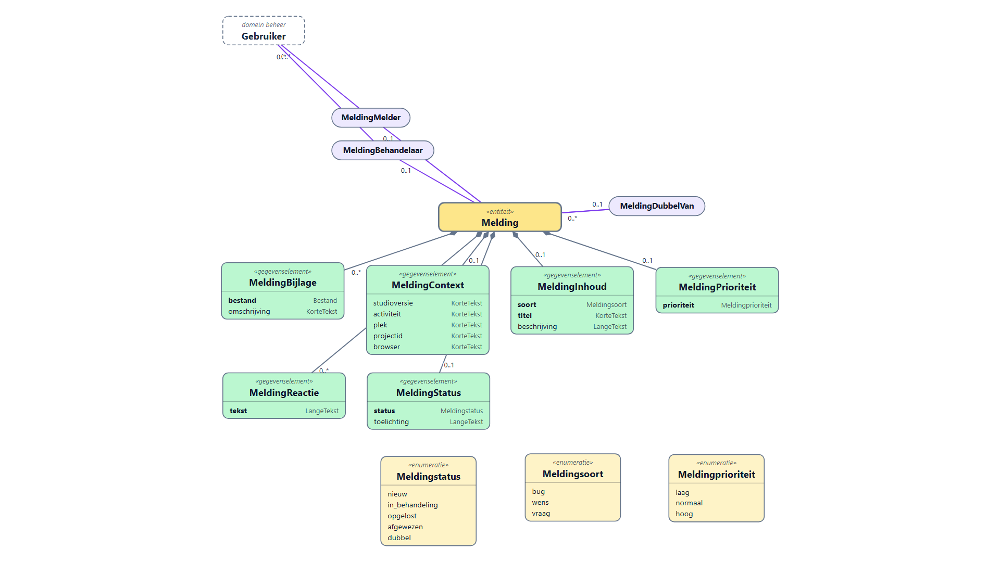

# Bugs en wensen melden vanuit Omnium (voorstel)

*2026-10-14. Aanleiding: Mark wil dat gebruikers (ook genodigden) vanuit de tool een bug, wens of
vraag kunnen indienen, met een schermafbeelding, zonder afhankelijk te zijn van GitHub. Status:
voorstel; model getekend met de eigen renderer. BACKLOG: HELP-3 (hoge prioriteit).*

## 1. Uitgangspunt: dogfooding

Een melding is een **gewone bitemporele entiteit** in het register (domein `meldingen`). Dan
krijgen we zonder eigen code: de gegenereerde API en GraphQL, formulieren, lijsten, de
geschiedenis (wie wijzigde de status wanneer), notificaties (NotificatieDefinitie → mail naar de
beheerder) en toegangsbeleid (Toegangsspraak/PEP: de melder ziet alleen de eigen meldingen).
Wat we wél bouwen is de **ingang in de Studio**: het formulier onder Help en het kader trekken.

**Waarom niet git?** Het git-protocol kent geen issues: git bewaart commits, bomen en tags.
Issues, pull requests en reviews zijn een functie van de **forge** (GitHub, GitLab, Gitea,
Forgejo), elk met een eigen API. Er bestaan git-native varianten die issues als git-objecten
opslaan (`git-bug`, `git-appraise`), maar die vragen een git-client bij de melder en passen niet
bij een melding met schermafbeelding uit een webtool. Een register-entiteit wel, en het is
precies wat Omnium moet kunnen. Eventueel later: een export of koppeling naar een forge.

## 2. Model

Bron: [`meldingen — v3-model.json`](meldingen%20—%20v3-model.json); tekening met `diagramsvg`
(dezelfde tekenaar als `/api/render/svg`), [`meldingen-model.svg`](meldingen-model.svg).

| Element | Momentvoorkomen | Materieel | Waarom |
|---|---|---|---|
| **Melding** (hub) | — | nee | De melding zelf. Wie en wanneer: de registratie (formele tijd), dus geen velden daarvoor. |
| MeldingInhoud | enkelvoudig | nee | soort (bug/wens/vraag), titel, beschrijving. Een correctie is formeel. |
| MeldingContext | enkelvoudig | nee | Door de Studio ingevuld: versie, activiteit/profiel, de plek onder de Alt-klik, project-id, browser. Helpt reproduceren. |
| MeldingBijlage | meervoudig | nee | Schermafbeelding of ander bestand; datatype `Bestand` (UUID in de filestore). |
| MeldingStatus | enkelvoudig | **ja** | nieuw → in behandeling → opgelost / afgewezen / dubbel, met toelichting aan de melder. Materieel: "opgelost per release". |
| MeldingPrioriteit | enkelvoudig | nee | Door de beheerder. |
| MeldingReactie | meervoudig | nee | Gesprek tussen melder en beheerder. |
| MeldingMelder → Gebruiker | enkelvoudig | nee | Zodat het beleid erop kan filteren ("eigen meldingen"). |
| MeldingBehandelaar → Gebruiker | enkelvoudig | ja | Wie hem oppakt. |
| MeldingDubbelVan → Melding | enkelvoudig | nee | Bij status dubbel. |

**Open punten voor Mark:**

1. Domein `meldingen` apart, of onder `beheer`? Apart houdt `beheer` admin-only; de melder moet
   de eigen meldingen kunnen lezen.
2. De relatie naar Gebruiker gaat over de domeingrens naar `beheer` (alleen beheerders lezen
   dat). Het beleid moet "melder = ik" kunnen toetsen zonder het hele Gebruiker-record te tonen.
   Alternatief: alleen de gebruikersnaam als veld. Voorstel: relatie, want dogfooding.
3. Prioriteit en behandelaar zichtbaar voor de melder? Voorstel: ja, reacties en status ook.

## 3. Ingang in de Studio

- **Help → Melden…** opent een klein formulier: soort, titel, beschrijving, bijlagen (plakken,
  slepen, bestand kiezen). De context vult de Studio zelf in en toont hem inklapbaar ("dit gaat mee").
- **Alt-klik waar dan ook** (of Help → Melden met schermafbeelding): het scherm dimt, je trekt een
  kader; de Studio maakt een afbeelding van dat gebied en opent het formulier met de afbeelding als
  bijlage en de plek onder de klik als context. Esc breekt af.
  - Techniek: `html-to-image` (zit al in de Studio, `diagramcore/export/exporteerCanvas.js`) op
  `document.body`, daarna bijsnijden tot het kader. Geen browser-permissie nodig (in tegenstelling
  tot `getDisplayMedia`). Canvas, SVG en tekst komen mee; iframes van andere origins niet.
  - Alt-klik botst niet met bestaande bediening? Na te lopen (canvas: Alt-slepen?). Anders
  Alt+Shift-klik.
- **Mijn meldingen** (Help-menu): lijst met status en reacties; reageren kan daar.
- De beheerder behandelt meldingen met de gewone lijst/formulieren van het register, plus een
  notificatie bij een nieuwe melding.

Use cases (zoals Mark ze noemde): *Gebruiker*: maak melding (bug/wens), bekijk status meldingen
(extend: voeg foto of document toe), bekijk help. *Beheerder*: behandel meldingen.

## 4. Volgorde

1. Model door codegen (`--domein meldingen`), tabellen, API; toegangsregel "melder ziet eigen".
2. Formulier onder Help + bijlage-upload via de filestore.
3. Alt-klik + kader → schermafbeelding.
4. Mijn meldingen + notificatie naar de beheerder.
